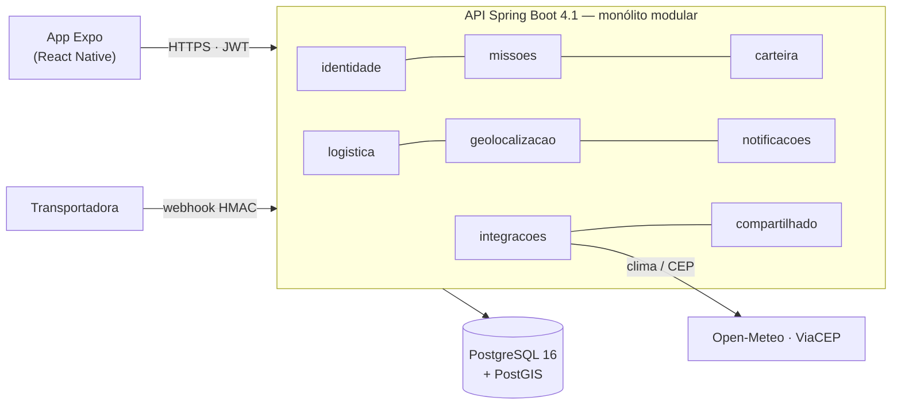
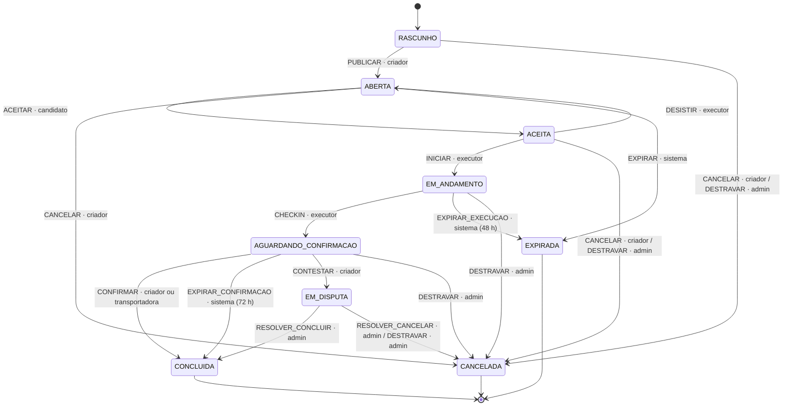

# Arquitetura

## Módulos

Raiz `com.omnitribo`, um pacote por módulo, cada um com `api/` (controllers, DTOs, portas),
`dominio/` (entidades, regras) e `infra/` (repositórios, clientes).

| Módulo | Responsabilidade |
|---|---|
| `identidade` | conta, JWT/refresh, perfil, XP e nível, consentimento LGPD, patrocinadores |
| `missoes` | missão, máquina de estados, recompensa, financiamento, check-in (o agregado é a missão) |
| `geolocalizacao` | registro de check-in e antifraude (portas em `api/`) |
| `carteira` | ledger, saldo, transferência, aporte, resgate, benefícios |
| `logistica` | entrega falida, ponto de custódia, modelo de risco |
| `notificacoes` | caixa de entrada in-app (alertas) |
| `integracoes` | clima e CEP com cache, disjuntor e retry |
| `compartilhado` | kernel, outbox, auditoria, erros, geoespacial, segurança, painel de impacto |

**Regra (ArchUnit, `RegrasArquiteturaTest`):** módulo só acessa outro por `api/` ou evento — nunca
repositório ou entidade JPA alheia. `compartilhado/infra` é privado; `compartilhado/{api,dominio}`
são livres. A regra é **direcional**: classes de `compartilhado` não importam tipos de módulo, e é
por isso que `ConsultasGeoespaciais` recebe status e categoria como `String`. Implementações de porta
são injetadas pela **interface**. `carteira` guarda `missao_id` como UUID puro, sem FK.

Portas mais usadas:
- `CreditoRecompensa`, `FinanciamentoMissao` e `AporteToken` (carteira);
- `ConversaoEntregaFalida` e `ConfirmacaoRetirada` (missoes);
- `BaixaCustodia` (logistica);
- `ConsultaClima` (integracoes — devolve `Optional` e nunca lança);
- `ConsultaPatrocinador`, `ProgressaoUsuario` e `ConsultaSessao` (identidade);
- `RegistroCheckin` (geolocalizacao);
- `DespachoAlerta` (notificacoes).

## Máquina de estados da missão

Nove estados e 20 transições, declaradas em `StatusMissao` e aplicadas **só** por
`MissaoStateMachine`.

`CONCLUIDA` é o único estado que credita. Todo estado não-terminal tem uma saída que não depende de
um humano específico: uma varredura por prazo ou a porta de ADMIN.

## O caminho da tese: entrega falida → missão

1. `POST /webhooks/transportadora` com HMAC sobre o corpo bruto. É idempotente por
   `(transportadora, codigoRastreio)`.
2. `logistica` trava a vaga do ponto de custódia (`FOR UPDATE`) e consulta o clima.
3. `PrevisorDeRisco` calcula a probabilidade de falha e a faixa, e daí sai o multiplicador
   **[1,00; 1,50]**.
4. `ConversaoEntregaFalida` cria a missão ABERTA (origem = ponto, destino = endereço do cliente) e a
   carteira do patrocinador financia o pote.
5. A outbox despacha o alerta para as tribos a até 3 km, só para quem tem consentimento, respeitando
   o teto por hora.
6. O vizinho aceita, inicia e faz check-in (raio de 200 m, acurácia ≤ 50 m) → a missão fica
   `AGUARDANDO_CONFIRMACAO`.
7. `POST /webhooks/transportadora/confirmacao` → `CONCLUIDA`, o executor é creditado e a custódia
   recebe baixa.

## Segurança

- **Auth:** JWT RS256 de 15 min, só em memória no app; refresh opaco com rotação de família, em
  `expo-secure-store`. Senha em Argon2id. O principal é reconstruído do banco a cada requisição
  (cache de 60 s).
- **Identidade vem sempre do JWT**, nunca do corpo, da query ou de header. Controller só trabalha
  com DTO.
- **Rate limit (bucket4j):**
  - login com bloqueio progressivo por `sha256(ip:email)`;
  - 100 escritas/min por usuário;
  - 120/min no webhook;
  - 12/min na busca por handle.
- **IP** só por `EnderecoDoCliente` (`getRemoteAddr`). `X-Forwarded-For` não é lido.
- **Erro:** RFC 9457 com `type` do catálogo `TipoProblema`. Nunca stack trace, SQL ou nome de
  classe.
- **Banco:**
  - a aplicação conecta como `omnitribo_app`, sem DDL;
  - `lancamento`, `auditoria` e `checkin` são append-only;
  - toda SQL é bindada, sem concatenação.
- **Idempotência:** a chave do cliente nunca é guardada crua quando a UNIQUE é global. O check-in
  grava `sha256(usuario|missao|chave)`.
- **Endereço residencial:** quem não participa da missão vê só o bairro, e coordenada exata não vai
  para log.

### Antifraude de check-in — o que ele não pega

Os controles são posição a ≤ raio, acurácia ≤ 50 m, `mocked` reportado pelo cliente e cinemática
(velocidade implausível entre check-ins). O que fica de fora:
- spoofing com root ou emulador é mitigável, não eliminável;
- `mocked` é autodeclarado;
- presença não é execução (por isso a transportadora confirma);
- conluio não é detectado;
- a cinemática é cega no primeiro check-in de cada conta.

## Stack e verificação

| Camada | Stack |
|---|---|
| Backend | Spring Boot 4.1, Java 21, Maven, Flyway, Caffeine, bucket4j, Jackson 3 |
| Banco | PostgreSQL 16 + PostGIS (`geography(POINT,4326)`; distância sempre derivada, nunca armazenada) |
| Mobile | Expo SDK 57, TypeScript strict, Expo Router, TanStack Query, Zustand, Zod |
| Testes | JUnit 5, Testcontainers (PostGIS real), ArchUnit, Jest, RTL, MSW |

`./mvnw verify` roda testes, Spotless, SpotBugs (`failOnError`) e dois gates JaCoCo sobre
`INSTRUCTION`: 80% global e 85% nos pacotes `dominio`. CI em `.github/workflows/`: `api.yml`,
`mobile.yml` e `security.yml` (gitleaks).
